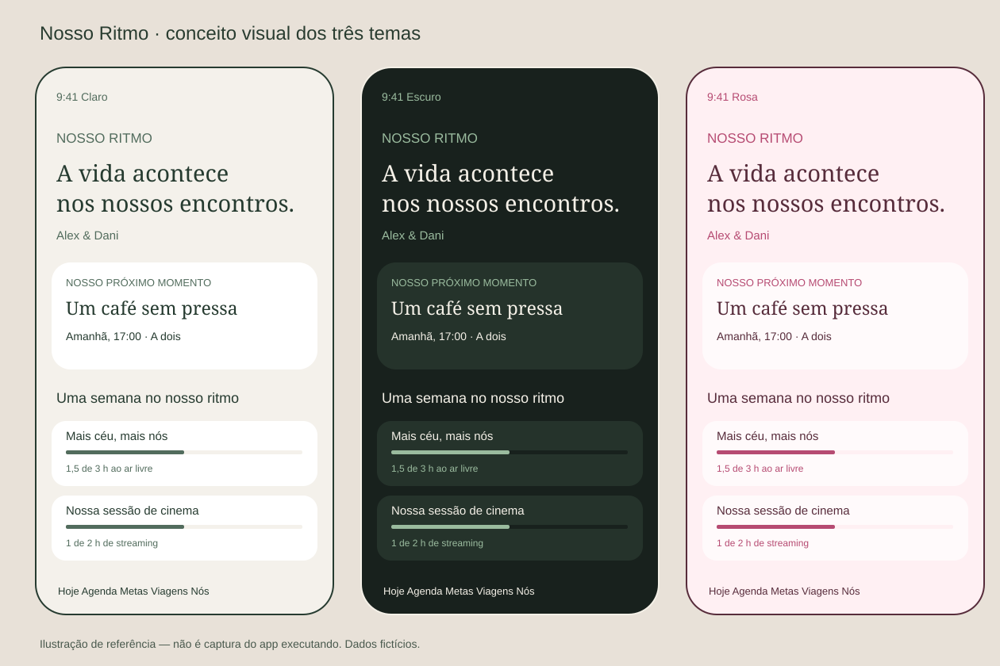

# Nosso Ritmo 💞

[](https://github.com/NyG007/nosso-ritmo-ios/actions/workflows/ios.yml)

Um calendário independente para cuidar da rotina a dois. App nativo para iPhone, em português, com agenda compartilhada, metas, estudos, academia, viagens, músicas e widgets.



> Projeto inicial para uso pessoal do casal. O código é público; o conteúdo do casal fica no armazenamento local e no iCloud privado/compartilhado. O GitHub não armazena os compromissos nem as atividades.

## O que está implementado

| Área | Recursos |
| --- | --- |
| Hoje | Próximos compromissos, atalhos de rotina, cronômetro e progresso semanal |
| Agenda | Calendário mensal e agenda diária, categorias, participantes, observações, lembretes e repetição diária/semanal |
| Metas | Horas semanais, frequência semanal ou conclusão até uma data; individuais ou conjuntas, visíveis aos dois |
| Estudos e academia | Matérias e treinos simples; agendamento e registro de sessões |
| Ar livre e streaming | Mínimos semanais configuráveis e histórico; título do filme/série |
| Viagens | Datas, roteiro, checklist, orçamento e despesas em reais; inclusão de paradas na agenda sem duplicação |
| Nós | Músicas por link e dedicatória, autoria e data |
| Aparência | Sistema, claro, escuro e rosa, com preferência por aparelho |
| Widget | Pequeno com próximo compromisso; médio com compromissos e metas de ar livre/streaming |
| Dados | Core Data local, CloudKit com convite privado para a segunda conta, sincronização posterior ao uso offline |

Não usa EventKit, Calendário do iOS, Google Agenda, rastreamento de localização ou reprodução integrada de músicas. O tempo é registrado manualmente ou com cronômetro.

## Começar no Mac

Requisitos: Mac com Xcode compatível com iOS 17+, Git e um simulador de iPhone. Python 3 é usado apenas pelos scripts de verificação/geração; não é uma dependência do app.

```sh
git clone https://github.com/NyG007/nosso-ritmo-ios.git
cd nosso-ritmo-ios
open NossoRitmo.xcodeproj
```

1. Selecione o esquema **NossoRitmo** e um simulador de iPhone.
2. Para executar sem configurar serviços Apple, use **Product → Build**, com assinatura desativada no simulador se necessário; a linha de comando está abaixo.
3. Toque em **Explorar demonstração**. Os exemplos Alex e Dani são inteiramente fictícios.
4. Explore as cinco abas e altere o tema em **Nós → Nosso espaço e preferências**.

```sh
xcodebuild -project NossoRitmo.xcodeproj -scheme NossoRitmo \
  -configuration Debug -sdk iphonesimulator \
  -destination 'generic/platform=iOS Simulator' \
  CODE_SIGNING_ALLOWED=NO build
```

O projeto Xcode já está incluído: não é necessário instalar XcodeGen, CocoaPods ou dependências externas. Abra o pacote `Package.swift` separadamente para executar os testes das regras no Xcode, ou use `swift test`.

**Para usar nos dois iPhones:** siga [Configuração Apple e iCloud](docs/SETUP.md). O modo demonstração não conecta os aparelhos. Os bancos demo e iCloud são separados; os exemplos não são migrados para o casal real.

## Como usar em casal

1. No primeiro iPhone, escolha **Começar com iCloud**, informe seu nome e crie o espaço.
2. Em **Nós → Preferências → Convidar minha pessoa**, informe o e-mail da conta iCloud da outra pessoa.
3. Prepare o convite e compartilhe o link privado. A interface permite apenas um convidado, inclusive convites pendentes.
4. No segundo iPhone, instale a mesma versão, escolha o modo iCloud e abra o link. **Não crie outro espaço nesse aparelho.** Aguarde a importação e informe o nome.
5. Cada pessoa pode criar, editar e excluir itens. Não há itens privados dentro do casal.

### Agenda e lembretes

Use **Agenda → +** para criar um compromisso. Toque em uma ocorrência para editar ou excluir. Em compromissos recorrentes, escolha **Só esta ocorrência** ou **Esta e próximas**. As exceções preservam o identificador da ocorrência original; alterações de horário podem levar o compromisso para outro dia.

Ative notificações em **Nós → Preferências** em cada iPhone e escolha o lembrete no compromisso. O app agenda até 60 lembretes futuros dentro dos próximos 30 dias e os atualiza ao abrir, sincronizar ou editar dados. Abra o app periodicamente para renovar esse horizonte. Atualizações do parceiro dependem da importação do iCloud; não há promessa de aviso imediato de toda edição.

### Metas e horas

- Defina os valores: não há mínimo imposto pelo app. Ar livre e streaming são ambos metas mínimas.
- Uma pessoa selecionada cria uma meta individual. Duas pessoas selecionadas, ou nenhuma seleção, representam atividades conjuntas. Todos podem acompanhar todas as metas.
- Só sessões concluídas contam. Agendar um treino ou estudo não registra tempo realizado.
- Uma sessão conjunta conta uma vez na meta do casal e também para cada participante na respectiva meta individual. Não inicie dois cronômetros para a mesma atividade conjunta: conclua em um aparelho.
- O cronômetro é local e persiste ao fechar o aplicativo. Ao concluir, o registro é sincronizado. É possível pausar e retomar.
- Para corrigir duração, título ou participantes, abra o item no histórico da atividade. Excluir ou corrigir recalcula o progresso.
- A semana começa na segunda-feira. Horas de sessões que cruzam a semana são divididas pelo intervalo de tempo. Sessões pausadas são distribuídas proporcionalmente ao tempo entre início e término; a frequência conta na semana do início.

### Viagens, músicas e widget

Crie a viagem, organize as paradas por dia, marque o checklist e registre despesas. **Adicionar à agenda** cria um único compromisso vinculado; as próximas atualizações reutilizam esse vínculo. Excluir uma parada remove o compromisso vinculado. Excluir a viagem remove seus itens e compromissos vinculados.

No mural **Nós**, compartilhe um link HTTPS do Spotify, Apple Music ou YouTube com uma dedicatória. O serviço musical abre fora do app.

Para adicionar o widget, mantenha a tela inicial pressionada e escolha **Editar → Adicionar Widget → Nosso Ritmo**. Toque no compromisso para abrir a agenda; as metas do widget médio abrem a aba Metas. O iOS decide quando redesenhar o widget. Os dados são renovados pelo app, sem consultar diretamente o iCloud na extensão.

## Desenvolvimento e verificação

```sh
swift test --parallel
python3 scripts/verify_project.py
```

O GitHub Actions executa a verificação estrutural, 18 testes Swift de calendário/metas/cronômetro, a compilação do app e widget para simulador em macOS e a abertura da demonstração nos três temas. As capturas reais ficam no artefato `simulator-screenshots` da execução. Não usa certificados ou credenciais Apple. O workflow não valida sincronização real entre contas.

Para regenerar o projeto após adicionar arquivos Swift:

```sh
python3 scripts/generate_project.py
```

O ícone geométrico e a ilustração de referência podem ser reproduzidos com `python3 scripts/create_assets.py`. A imagem acima é uma ilustração do design; capturas reais e a revisão visual final devem ser feitas no simulador/Mac.

Leia [Arquitetura](docs/ARCHITECTURE.md), [Roteiro de testes](docs/TESTING.md) e [Estado da entrega](docs/STATUS.md). Licença [MIT](LICENSE).
